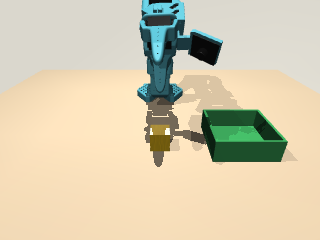

# LLM-Robot

用视觉语言模型将自然语言和图片转换成经过校验的动作序列，在 ROS 2 turtlesim、MuJoCo 移动底座或 SO-101 桌面仿真中执行。原课程项目说明保存在 [docs/README-2024.md](docs/README-2024.md)。

项目有三个可独立运行的仿真示例。每个示例都能执行仓库里的 JSON 计划，也可以用本地 Ollama 或 OpenAI API 根据文字和单张图片生成计划。

| 后端 | 运行示例 | 动作 |
| --- | --- | --- |
| ROS 2 turtlesim | 启动节点，执行红色方形计划 | 移动、旋转、正方形、画笔、停止 |
| MuJoCo 移动底座 | 执行移动与旋转计划，导出仿真相机图 | 移动、旋转、正方形、停止 |
| SO-101 桌面仿真 | 执行回零、打开和关闭夹爪 | 回零、夹爪开合、停止 |

## ROS 2 turtlesim

Ubuntu 22.04 对应 ROS 2 Humble。可使用[鱼香 ROS](https://github.com/fishros/install) 安装，按界面选择 ROS 2 Humble 桌面版；安装过程会请求 sudo 密码，注意阅读换源选项。另需 `python3-colcon-common-extensions` 和 `ros-humble-turtlesim`：

```bash
sudo apt install python3-colcon-common-extensions ros-humble-turtlesim
source /opt/ros/humble/setup.bash
```

在仓库根目录使用系统 Python 3.10 构建（请退出可能影响 ROS 的 conda 环境）：

```bash
source /opt/ros/humble/setup.bash
colcon build --packages-select rosgpt
source install/setup.bash
```

### 运行演示

在已 source 两个 setup 文件的终端启动 turtlesim 和控制器：

```bash
ros2 launch rosgpt demo.launch.py
```

另开终端，在仓库根目录加载同样的 ROS 环境。下面的演示可以直接执行，无需启动 Ollama。

```bash
source /opt/ros/humble/setup.bash
source install/setup.bash
ros2 run rosgpt rosgpt --execute-plan examples/red_square.json
```

### 用 Ollama 生成计划

安装 [Ollama](https://docs.ollama.com/linux)，启动服务后获取模型：

```bash
ollama pull qwen3-vl:2b-instruct
```

如果 Ollama 安装在用户目录并配置了用户级 systemd 服务，可以用 `systemctl --user status ollama` 查看状态，使用 `systemctl --user start ollama` 启动。该服务随用户会话启动。

默认使用约 1.9 GB 的 Qwen3-VL 2B Instruct。同一模型处理纯文本和图片，要求 Ollama 0.12.7 或更新版本。可用 `OLLAMA_MODEL` 改用其他模型，例如本机已有的 `qwen3-vl:4b`。`OLLAMA_HOST` 可配置服务地址。 [Ollama 模型说明](https://ollama.com/library/qwen3-vl:2b-instruct)

使用 Ollama 时，可以先保存并检查计划，再执行同一个文件。

```bash
ros2 run rosgpt rosgpt '前进一米，逆时针转90度' --save-plan /tmp/robot-plan.json
ros2 run rosgpt rosgpt --execute-plan /tmp/robot-plan.json
```

在生成计划的命令上添加 `--execute` 可直接发布。画方形的文字示例为 `ros2 run rosgpt rosgpt '把画笔设为红色，画一个边长0.4的正方形' --execute`。画笔通过 turtlesim 的服务设置，正方形将按顺序执行。发布成功只表示消息已发送；控制器忙碌、服务不可用或超时仍会拒绝或中断执行，请查看启动终端的日志。

视觉输入示例（需要有视觉能力的模型）：

```bash
ros2 run rosgpt rosgpt '如果图片里箭头指向左边，逆时针旋转45度；否则停止。' --image examples/left_arrow.png
```

可将图片路径替换为自己的图片，并添加 `--execute` 执行生成的动作。图片经 Ollama 提供给模型作为上下文，不是相机实时订阅；没有实现目标定位、抓取或导航。模型可能忽略约束或识别错误。控制器忙时拒绝新计划，紧急停止可绕过模型：

```bash
ros2 topic pub --once /voice_cmd std_msgs/msg/String '{data: "{\"actions\":[{\"action\":\"stop\"}]}"}'
```

停止依赖 ROS 通信与控制器进程，只用于此仿真原型。位姿停止更新、动作超时或收到 stop 会发布零速度并丢弃剩余队列；进程异常退出、网络通信中断无法保证可靠停车。系统不应直连真实机器人。

## MuJoCo 仿真

底盘采用 Stanford TidyBot 的 MuJoCo Menagerie 版本，固定在提交 `71f066ad0be9cd271f7ed58c030243ef157af9f4`。仓库内附上游底盘 MJCF、五件 STL 网格和 MIT 许可。上游模型基于底盘 CAD，使用平面的 x、y 与朝向三个关节和位置执行器。项目补充了地面、色标、相机和把动作转换成位置参考的控制器。仿真范围是平面运动与规划验证，轮胎和机构传动不在模型范围内。 [Stanford TidyBot 项目](https://tidybot.cs.princeton.edu/) · [固定版本的上游资产](https://github.com/google-deepmind/mujoco_menagerie/tree/71f066ad0be9cd271f7ed58c030243ef157af9f4/stanford_tidybot) · [MIT 许可](rosgpt/assets/tidybot-LICENSE)

MuJoCo 可以与 ROS 分别安装在独立 Python 环境中。以下命令在项目根目录运行。

如果系统 Python 报 `ensurepip is not available`，先安装 Ubuntu 的 `python3-venv` 包；也可以使用已有的 Conda 环境。

```bash
python -m venv .venv-mujoco
source .venv-mujoco/bin/activate
python -m pip install -r requirements-mujoco.txt

# 使用已有计划，离线执行；有桌面会话时可额外加 --view。
python -m rosgpt.mujoco_demo --plan examples/move_and_turn.json --execute

# 让视觉模型观察仿真相机，并执行结果。
python -m rosgpt.mujoco_demo '如果图片里有红色圆形标记，就前进0.5个单位，否则停止。' --observe --execute --snapshot /tmp/robot-camera.png
```

`--observe` 和 `--snapshot` 渲染的是 MuJoCo 场景内的虚拟相机，不会读取桌面或真实摄像头。无显示器时程序默认使用 EGL 离屏渲染；EGL 不可用的环境需要配置可用的 MuJoCo 渲染后端。`--view` 在执行期间打开 MuJoCo 窗口。以下示例图直接由模拟器渲染：


示例目前只用图像中的颜色条件选择已知动作，没有做物体定位、导航或抓取。MuJoCo 后端不支持 turtlesim 的画笔动作；生成计划和读取计划时都会检查后端能力。

### 闭环规划与评测

TidyBot 的评测任务要求找到指定颜色的圆标并停在中心附近。每轮采集新相机图和位姿，几何规划器为两个标定位置分别生成一个候选动作，模型根据画面选择对应动作。Harness 校验动作是否匹配候选，最多运行六轮。它输出每轮图像、动作和位姿，并用 MuJoCo 中的真实目标位置判分。执行停止且误差不超过 0.08 个单位才算通过。`--swap` 交换两个圆标的颜色，可以检查固定路线在场景改变后是否仍到达正确目标。

```bash
# 先用固定动作离线复现。每次运行会创建新的结果目录。
run_dir=$(mktemp -d)
python -m rosgpt.mujoco_harness --replay examples/tidybot_waypoint.json --out "$run_dir/replay"

# 默认用本地 Ollama
python -m rosgpt.mujoco_harness --swap --out "$run_dir/ollama"

# 已在环境中配置 OPENAI_API_KEY 时可选用 GPT-6.2 Astra
ROSGPT_PROVIDER=openai python -m rosgpt.mujoco_harness --model gpt-6.2-astra --out "$run_dir/openai"
```

每次运行的 `report.json` 记录最终误差和通过状态，进程退出码也会反映结果。离线回放用于复现控制与判分。OpenAI 接口使用 Chat Completions 的图片输入和 JSON 模式，实际调用会上传仿真相机图。 [GPT-6.2 Astra API 文档](https://developers.openai.com/api/docs/models/gpt-6.2-astra)

## MuJoCo SO-101 桌面仿真

SO-101 使用固定提交的 LeRobot 桌面模型。首次下载需要联网，下载到用户缓存。运行器会加载该版本的 Python 环境代码。已有可信的本地副本时，可以用 `--env-dir` 指定目录。

```bash
python -m venv .venv-so101
source .venv-so101/bin/activate
python -m pip install -r requirements-so101.txt
python -m rosgpt.so101_demo --download --plan examples/so101_gripper.json --execute \
  --snapshot /tmp/so101-before.png --final-snapshot /tmp/so101-after.png
```

再次运行可以省略 `--download`。示例输出每个动作后的仿真关节读数。输入文字时可以加 `--observe`，将前置仿真相机图提供给 Ollama。



## 验收

从仓库根目录运行单元测试。安装 `requirements-mujoco.txt` 后，测试会执行 MuJoCo 物理和离屏渲染用例。

```bash
python3 -m unittest discover -s tests -v
```

整体验收用同一个选定的模型先跑纯文字移动，再跑闭环视觉任务。连续调用同一入口会在每轮重新渲染相机图，把当前位置和图像一起传给模型，执行下一步动作，再重新观测。验收目录包含 `text.json`、每轮截图和视觉 `report.json`。

```bash
run_dir=$(mktemp -d)
PYTHONPATH=. python tests/model_acceptance.py --out "$run_dir/local"

# 交换红蓝圆标，验证图像变化能改变最终选择
PYTHONPATH=. python tests/model_acceptance.py --swap --out "$run_dir/swapped"

# 已配置 OPENAI_API_KEY 时，使用同一验收覆盖 API 的纯文字和视觉输入
ROSGPT_PROVIDER=openai PYTHONPATH=. python tests/model_acceptance.py --out "$run_dir/openai"
```

ROS 验收使用独立 DDS 域和无窗口 turtlesim。离线模式检查保存计划执行、位姿反馈、运行中停止、整数速度和画笔服务。启用 Ollama 后还检查中文指令、图片条件动作及计划保存。

```bash
source /opt/ros/humble/setup.bash
source install/setup.bash
/usr/bin/python3 tests/ros_acceptance.py --offline
/usr/bin/python3 tests/ros_acceptance.py
```

如果 ROS 无法写入默认日志目录，可设置 `ROS_LOG_DIR` 指向可写目录。控制器与 turtlesim 需要 DDS 通信，模型验收还需要访问 `OLLAMA_HOST`。

[实现说明](docs/architecture.md) · [2024 年课程项目归档](docs/README-2024.md)

[公开机器人操作评测与复现记录](docs/robotics-evaluation.md)
